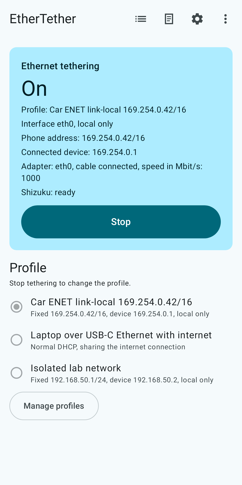

<!--
SPDX-FileCopyrightText: 2026 Oytun Cagil Koltuk
SPDX-License-Identifier: Apache-2.0 OR GPL-3.0-or-later
-->

# EtherTether

EtherTether starts and stops Android's built-in Ethernet tethering for a USB or USB-C Ethernet adapter. Plug in the adapter, pick a profile, tap Start.



Two modes:

- Fixed address: the phone takes an IPv4 address you choose, for example `169.254.0.42/16`, and offers one matching address to the device on the other end. This reaches devices that only speak link-local or a fixed subnet, such as diagnostic interfaces, lab equipment and embedded boards.
- Normal sharing: Android's usual DHCP tethering, optionally sharing the phone's internet connection.

Start and stop from the app, the notification, a Quick Settings tile or a home-screen widget. With **Keep armed**, EtherTether asks Android again whenever the adapter is removed, so the next adapter you plug in is served by itself; **Start after restart** arms your profile after a reboot once Shizuku runs. Profiles can be exported and imported as a small JSON file.

Stop returns everything to normal. EtherTether changes nothing beyond the tethering request: no routes, no DNS, no Wi-Fi or mobile data settings, no firewall rules.

Version 1.0.0, tested on a POCO F7 (Android 16, HyperOS 3) with a USB-C Ethernet adapter. If you try it on another phone or adapter, please open an issue either way; working setups go into [docs/COMPATIBILITY.md](docs/COMPATIBILITY.md).

## How it works

Android has supported tethering over USB Ethernet adapters since Android 11, and its tethering service accepts a request with a fixed address. Ordinary apps are not allowed to make that request; it takes the shell identity, which you can hand to EtherTether through [Shizuku](https://shizuku.rikka.app/). Shizuku runs on the phone itself, started with wireless debugging (no computer needed) or with ADB, and has to be started again after every reboot.

EtherTether uses that access only to start, stop and read Ethernet tethering. Sui and plain root are not supported; on a rooted phone, start Shizuku the normal way. How the request travels through the app is described in [docs/ARCHITECTURE.md](docs/ARCHITECTURE.md), and the reasoning behind the design in [docs/DESIGN.md](docs/DESIGN.md).

## Not for plugging the phone into a router

EtherTether makes the phone the host of a small cable network: it gives the phone an address and offers one address to the device on the other end (Android's DHCP server). It is for devices that need the phone, such as a laptop, a car's diagnostic port or lab equipment.

To get internet from a router or modem over a cable, do not use EtherTether: stop it, turn off **Keep armed**, and plug the adapter in again. Android then uses the adapter as a normal wired connection by itself (if the phone maker kept that feature). While EtherTether runs or is armed, Android uses every adapter for tethering instead, and on a router's network the phone would offer addresses that clash with the router's own.

## Requirements

- Android 11 (API 30) or newer.
- A USB or USB-C Ethernet adapter that Android recognises. Common chipsets such as Realtek RTL8153 and ASIX AX88179 have drivers in Android's standard kernels; what is verified on real phones, and what is not yet, is listed in [docs/COMPATIBILITY.md](docs/COMPATIBILITY.md).
- [Shizuku](https://shizuku.rikka.app/), started with wireless debugging or ADB.

## Install

Signed APKs are available from:

- GitHub Releases of this repository: download `EtherTether-X.Y.Z.apk`.
- Obtainium, which installs and updates directly from GitHub Releases: tap the badge on the phone with Obtainium installed, or add `https://github.com/oytuncagil/ethertether` in Obtainium by hand.

  [](obtainium://add/https://github.com/oytuncagil/ethertether)
- Other listings are planned; see [docs/LISTINGS.md](docs/LISTINGS.md).

On the first install, Google Play Protect may say that it has not seen apps from this developer yet. Tap **More details**, then **Install anyway**. Google's developer verification and EtherTether's status are explained in [docs/DEVELOPER_VERIFICATION.md](docs/DEVELOPER_VERIFICATION.md).

### Signing certificate

Every official APK is signed with the same release key. Its certificate SHA-256 fingerprint:

```
75:37:BE:B7:0C:8E:EF:0E:39:88:1F:A9:BC:4A:1C:37:DE:FC:97:86:29:AC:DE:4E:A3:85:B8:24:31:1D:05:7B
```

`apksigner` prints the same value in lower case without colons: `7537beb70c8eef0e39881fa9bc4a1c37defc978629acde4ea385b824311d057b`.

The About screen in the app says whether the installed copy is signed with the official release key. Verifier apps such as AppVerifier can check it too. How to verify a download, and how to rebuild the APK from the source and compare it (the release build is reproducible): [docs/RELEASING.md](docs/RELEASING.md#verifying-a-release).

## Starting Shizuku with wireless debugging

1. Install Shizuku from its [official download page](https://shizuku.rikka.app/download/).
2. Enable Developer options (tap Build number seven times in Settings, About phone), then turn on Wireless debugging.
3. In Shizuku, choose to start with wireless debugging and pair using the pairing code shown in Wireless debugging.
4. Open EtherTether and follow the introduction; tap **Grant access** when it asks.

Shizuku stops when the phone restarts; start it again after each reboot. Shizuku 13.6 and later can start by itself after a restart on Android 13 and later when the phone is on a trusted Wi-Fi network.

## Languages

English, Turkish and German. On Android 13 and later the language can also be set per app in the phone's settings. Translations into more languages are welcome; see [CONTRIBUTING.md](CONTRIBUTING.md).

## Privacy

EtherTether collects nothing. It has no INTERNET permission (the build fails if anything adds it), no analytics, no crash reporting, no ads and no accounts. Logs stay on the phone until you export them yourself. Details: [PRIVACY.md](PRIVACY.md).

## Building from source

Requirements: JDK 21 and the Android SDK with platform `android-37.0` and build tools 37.0.0.

```bash
./gradlew assembleDebug
```

The APK is written to `app/build/outputs/apk/debug/`. See [CONTRIBUTING.md](CONTRIBUTING.md) for the full checks.

## Contributing

Contributions are welcome under the project's licenses, with a Developer Certificate of Origin sign-off on every commit. Read [CONTRIBUTING.md](CONTRIBUTING.md) and the [code of conduct](CODE_OF_CONDUCT.md). Report security problems privately as described in [SECURITY.md](SECURITY.md).

## License

Copyright 2026 Oytun Cagil Koltuk.

EtherTether is licensed under either of

- the Apache License, Version 2.0 ([LICENSE-APACHE](LICENSE-APACHE)), or
- the GNU General Public License, version 3 or (at your option) any later version ([LICENSE-GPL](LICENSE-GPL)),

at your option. SPDX: `Apache-2.0 OR GPL-3.0-or-later`. Third-party notices are in [NOTICE](NOTICE).

## Name and logo

The name EtherTether and its logo identify the official app published from this repository. You are welcome to fork the code under its licenses, but please give your fork its own name, its own icon and its own application id, so that users can always tell an official build from a modified one.

Shizuku and Sui are projects of RikkaApps and are not affiliated with EtherTether.
